  

# 🚀 Awesome Declarative UI Frameworks & Web Components

  
  
  
  
  
  

## 🌟 Top Declarative UI Frameworks, Standards-Based Web Components & Design Systems

> A production-grade curated catalog of SaaS platforms, hosted visual testing workflows, enterprise design systems, and open-source GitHub repositories. Explore framework-agnostic W3C Custom Elements, Shadow DOM v1 encapsulation, fine-grained reactivity, unstyled accessible UI primitives, and modern component workshops.

**Last updated: November 2026**

---

### 🔍 Quick SEO Keywords & Taxonomy
`declarative-ui` • `web-components` • `custom-elements` • `shadow-dom` • `design-systems` • `lit` • `stencil` • `shoelace` • `web-awesome` • `shadcn-ui` • `radix-ui` • `chakra-ui` • `mantine` • `storybook` • `chromatic` • `tailwind-css` • `micro-frontends` • `component-driven-development`

This repository tracks notable **SaaS/hosted platforms** and **open-source projects** for **Declarative UI Frameworks & Web Components**. These tools author, compile, encapsulate, preview, test, and distribute declarative user interfaces and framework-agnostic Custom Elements / Shadow DOM Web Components across modern web applications, design systems, and micro-frontends.

**Open-source emphasis**: Standards-based Web Components (`Lit`, `Stencil`, `Shoelace / Web Awesome`, `FAST`, `ppmpreetham/BUI`), declarative UI frameworks (`React`, `Vue`, `Svelte`, `SolidJS`, `Qwik`), component libraries & accessible primitives (`shadcn/ui`, `Radix UI`, `Mantine`, `Chakra UI`, `Flowbite`), and self-hosted component workshops (`Storybook`, `Histoire`, `Ladle`) — ideal for frontend architects, design-system engineers, web-platform developers, and full-stack builders.

Contributions welcome! Open a PR to add/update entries. Keep descriptions factual and link to official sites.

---

## 📑 Table of Contents

- [📊 Sector Overview & Market Dynamics](#-sector-overview--market-dynamics)
- [☁️ SaaS/Hosted Platforms](#️-saashosted-platforms)
- [💻 Open-Source GitHub Projects](#-open-source-github-projects)
- [🤝 How to Contribute](#-how-to-contribute)
- [💖 Support](#-support)
- [📈 Star History](#-star-history)
- [⚖️ Disclaimer](#️-disclaimer)

---

## 📊 Sector Overview & Market Dynamics

The global market for UI/UX design tools and design system platforms is estimated at $2.6B to $3.2B (with the broader application development software sector exceeding $370B), growing at a CAGR of 15% to 22%. The sector is moderately fragmented across specialized categories such as component registries, visual regression testing, and unstyled accessible primitives, while frontend hosting infrastructure and enterprise app delivery demonstrate concentrated, winner-take-most dynamics dominated by scaled platforms like Vercel and OutSystems.

---

## ☁️ SaaS/Hosted Platforms

| Platform | Description | Pricing (Starting Tier) | Free Tier Limits | Company Size (Valuation / Revenue) |
|---|---|---|---|---|
| **[Ionic Appflow & Enterprise Design Systems](https://ionic.io)** (OutSystems) | Cloud build, live preview, and enterprise support platform for cross-framework Web Component UI kits and design systems. | $49/month (Standard tier historical starting price; enterprise custom) | Free tier limited to 500 Live Update MAUs and 100 native build minutes/month (OutSystems Personal Edition allows up to 100 internal users for non-production development). | Valuation: $9.5B / Revenue: ~$537M ARR |
| **[Vercel](https://vercel.com)** | Cloud frontend deployment and developer experience platform optimized for declarative UI frameworks with instant preview URLs. | $20/seat/month (Pro plan) | Free forever (Hobby plan): Strictly non-commercial use, 100 GB Fast Data Transfer/month, 1M Function Invocations/month, 4 hours active CPU/month. | Valuation: $9.3B / Revenue: ~$340M ARR |
| **[Radix UI Pro / WorkOS UI Ecosystem](https://radix-ui.com)** | Enterprise UI engineering ecosystem and commercial tooling built around accessible Radix primitives. | $125/connection/month (Enterprise SSO & SCIM Directory Sync starting tier) | Free forever (AuthKit tier): Free up to 1,000,000 Monthly Active Users (MAUs); core Radix UI primitives are 100% free and open-source under MIT with no limits. | Valuation: $2.0B / Revenue: ~$25M ARR |
| **[Chromatic (by Storybook Maintainers)](https://chromatic.com)** | Cloud visual regression testing, UI review, and hosted Storybook publishing platform catching pixel-level bugs on pull requests. | $149/month (Starter plan) | Free forever: 5,000 visual snapshots/month, Chrome-only testing, unlimited collaborators (unlimited snapshots available for qualifying open-source). | Valuation: ~$100M+ (Est.) / Revenue: ~$15M ARR |
| **[Bit.dev (Bit Cloud)](https://bit.cloud)** | Composable component-driven development and cloud registry platform for building, testing, and collaborating on UI components. | $25/seat/month (Pro plan) | Free forever: Unlimited public scopes and public components, core platform access, and 25 monthly credits (100 GB deployment bandwidth free). | Cumulative Funding: $36M / Revenue: ~$20M ARR |
| **[Tailwind Plus (formerly Tailwind UI)](https://tailwindcss.com)** | Commercial UI component and template library offering hundreds of responsive application UI, marketing, and e-commerce blocks. | $299 one-time payment (Lifetime Personal/Solo Developer License; $979 Team License) | No full-library free plan; free access limited to sample component previews and open-source companion libraries (Tailwind CSS, Headless UI, Heroicons under MIT). | Cumulative Revenue: ~$15M+ / Annual Gross: ~$3M–$5M |
| **[Flowbite Pro](https://flowbite.com)** | Commercial design system and UI kit extending open-source Flowbite with Figma design tokens, dashboard templates, and blocks. | $299 one-time payment (Single Developer lifetime license; $99/month for small teams) | Free forever (Community edition): 600+ components under MIT license with no revenue or traffic caps (commercial pro templates require paid license). | Bootstrapped / Estimated Revenue: ~$2M ARR |
| **[Web Awesome Pro (formerly Shoelace Pro by Font Awesome)](https://webawesome.com)** | Commercial tier extending open-source Shoelace Web Components with layout primitives, rich data components, and themes. | $228/seat/year (~$19/seat/month billed annually) | Free forever (Web Awesome Core): Standard web components and core assets under MIT license with zero usage or pageview caps. | Bootstrapped & Crowdfunded / Revenue: ~$1.7M ARR |

---

## 💻 Open-Source GitHub Projects

Sorted by star count (descending):

1. **[React](https://github.com/facebook/react)**   
   The industry-defining open-source declarative UI library for web and native user interfaces, championing component-driven architecture and virtual DOM reconciliation.

2. **[shadcn/ui](https://github.com/shadcn-ui/ui)**   
   Beautifully designed, accessible, copy-paste declarative UI components styled with Tailwind CSS and powered by Radix UI / Base UI primitives.

3. **[Storybook](https://github.com/storybookjs/storybook)**   
   Industry-standard frontend workshop environment for building, documenting, and testing UI components and Web Components in isolation across all modern frameworks.

4. **[Svelte](https://github.com/sveltejs/svelte)**   
   Radical compiler-based declarative UI framework converting components into highly optimized vanilla JavaScript without virtual DOM overhead, featuring native custom elements compilation.

5. **[Vue](https://github.com/vuejs/core)**   
   Progressive, approachable declarative UI framework featuring fine-grained reactivity, Single-File Components (SFCs), and first-class custom element compilation via `defineCustomElement`.

6. **[Chakra UI](https://github.com/chakra-ui/chakra-ui)**   
   Modular, accessible component library and design system engine built on Zag.js / Ark UI state machines with semantic tokens for rapid declarative UI authoring.

7. **[SolidJS](https://github.com/solidjs/solid)**   
   Hyper-performant declarative UI library utilizing fine-grained reactive primitives that update real DOM nodes directly without virtual DOM reconciliation.

8. **[Mantine](https://github.com/mantinedev/mantine)**   
   Full-featured React declarative UI framework and hooks suite featuring 100+ customizable accessible components, form validation, notifications, and dark mode.

9. **[Qwik](https://github.com/QwikDev/qwik)**   
   Resumable, instant-loading declarative UI framework designed for zero-hydration delivery and seamless custom element interoperability.

10. **[Lit](https://github.com/lit/lit)**   
    Google's flagship lightweight library for building fast, standards-based W3C Web Components with reactive state, scoped Shadow DOM styles, and declarative HTML templates.

11. **[Radix UI Primitives](https://github.com/radix-ui/primitives)**   
    Unstyled, accessible UI primitives for building production-ready design systems and declarative components compliant with WAI-ARIA standards.

12. **[Shoelace / Web Awesome](https://github.com/shoelace-style/shoelace)**   
    Leading open-source collection of professionally designed, framework-agnostic Web Components built on Lit that run seamlessly in React, Vue, Svelte, Angular, and HTML.

13. **[Stencil](https://github.com/ionic-team/stencil)**   
    Ionic's compiler that generates standards-compliant, lazy-loaded Web Components combining TypeScript, JSX, and virtual DOM reactivity with framework wrappers.

14. **[Microsoft FAST](https://github.com/microsoft/fast)**   
    Adaptive interface technologies and W3C Web Component primitives from Microsoft engineered for enterprise design systems across web applications.

15. **[Flowbite](https://github.com/themesberg/flowbite)**   
    Open-source interactive component library built on Tailwind CSS featuring modals, dropdowns, navbars, and data-attribute driven JavaScript interactions.

16. **[Ark UI](https://github.com/chakra-ui/ark)**   
    Framework-agnostic headless UI component library powered by finite state machines for React, Vue, and Solid applications.

17. **[Zag.js](https://github.com/chakra-ui/zag)**   
    UI component logic and interaction design modeled as state machines that can be consumed by any framework, Custom Elements, or vanilla JavaScript.

18. **[Histoire](https://github.com/histoire-dev/histoire)**   
    Fast, interactive component book and documentation workshop powered by Vite, providing first-class support for Vue, Svelte, and modern UI components.

19. **[Ladle](https://github.com/tajo/ladle)**   
    Ultra-fast, Vite-native alternative to Storybook engineered for instant startup, zero configuration, and rapid isolated component testing.

20. **[ppmpreetham/BUI](https://github.com/ppmpreetham/BUI)**   
    Declarative UI component toolkit engineered for clean, modular interface composition and streamlined frontend workflows.

21. **[Lion](https://github.com/ing-bank/lion)**   
    ING Bank's core open-source suite of accessible, white-label Web Component primitives built on Lit for robust corporate design systems.

---

## 🤝 How to Contribute

1. 🍴 Fork the repository.
2. 📝 Add or update entries in `README.md` (keep descriptions clear, concise, and factual).
3. 🔗 Verify all links, star badges, and category headers before submitting.
4. 🚀 Submit a Pull Request with a short summary of the additions.

---

## 💖 Support

Thank you for exploring and using this repository! If this curated collection helps you build better design systems, declarative user interfaces, or Web Components, please consider supporting this project:

- ⭐ **Star this repository** to help others discover it across GitHub.
- 🍴 **Fork & Share** it with your engineering team, design-systems peers, and social networks.
- ☕ **Buy me a coffee / Sponsor**: If you'd like to back ongoing maintenance and open-source contributions, visit the [Sponsor Dashboard](https://github.com/sponsors/ishandutta2007) to sponsor via GitHub Sponsors.

---

## 📈 Star History

---

## ⚖️ Disclaimer

- This is a **community-curated** list — not exhaustive and not an official corporate endorsement.
- When mixing Shadow DOM Web Components (`Lit`, `Shoelace`) with utility-first CSS frameworks like Tailwind CSS, configure CSS custom properties (`--var`) and `::part()` selectors intentionally so styles pierce encapsulation cleanly.
- Verify browser support and SSR / Declarative Shadow DOM hydration behavior when deploying Web Components in server-rendered applications.

---

  <b>Built for frontend architects, design-system engineers, web-platform developers, and open-source contributors worldwide.</b> 
  Let's make declarative UI frameworks and Web Components more open, interoperable, and accessible.

